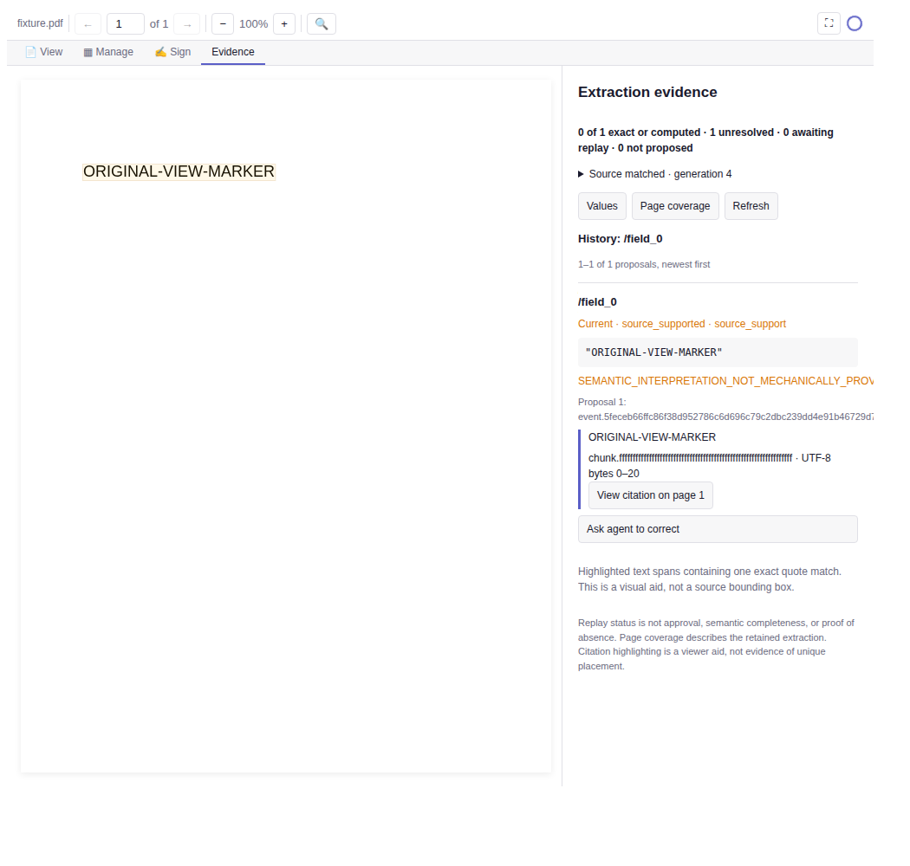

# Astra handoff: receiving validation

This record supplements the original implementation handoff; it does not
replace its failed or incomplete runs. It qualifies a code PR, not a release,
installed-host acceptance, or a public extraction-performance claim.

## Exact source

- Original archive SHA-256:
  `4cd2e4a928d0508ab76cfed642b63db4c8f5b8471ecd5c7c75aa50d38545e66a`.
- Imported base: `ac856ca7ff007354568febb0604a3f5cb43f1fd6`.
- Original handoff: `eb134ef348c65f4f1ea167125807cf7b90605901`.
- Clean receiving code/test checkpoint:
  `0d06c54409f88ad0ec08a9c36a8abdbe6ac96854`.

The final documentation/screenshot commit follows that checkpoint and changes
no executable source, tests, dependencies or built viewer bytes. Evidence
below remains attributed to the tested checkpoint, not a later Git identity.
Original history and the shared dirty checkout were preserved.

## Receiving fixes

Actual Chromium execution found that thumbnail pointerup rebuilt the grid
before the subsequent click could select a page. The correction preserves the
click target unless a drag actually reorders pages, with a regression and both
built viewer copies updated.

Three new test fixtures needed physical temporary paths on macOS, where
`/var` aliases `/private/var`. Only their fixture roots changed; production
path guards remained intact. A cross-process bootstrap test gained explicit
bounded child/test budgets without changing its taint assertions or product
deadlines.

The first full scorer attempt failed when verbose diagnostics exceeded an
8 MiB capture buffer. The receiving runner now drains diagnostics while
retaining at most 64 KiB per stream, full-stream byte counts and SHA-256,
and the original 60-minute deadline. Its exclusive response file remains the
score protocol. Fourteen regression cases and a bounded independent review
accepted the correction. Converter, Python bridge and upstream test classes
were unchanged.

## Observed gates

| Gate | Receiving result |
| --- | --- |
| Unfiltered Mac `npm run test:all`, Node 22.23.2 / Darwin x64 | Exit 0; Vitest 4,136 passed, 109 conditional skips, zero failures; native 99 passed, nine conditional skips, zero failures |
| Corrected Mac focused bank | 52/52 across five files |
| Real built Chromium viewer, synthetic MCP bridge | 8/8 |
| Focused viewer/Evidence/compatibility | 43/43 |
| Synthetic workflow with independent pypdf readback | 12/12, qualified |
| Python OCR proposal contract | 24/24 |
| Linux loopback and qpdf password truth | 62/62 |
| Linux native partition with explicit system qpdf | 101 passed, seven macOS-only skips, zero failures |
| Actual source/share Tesseract stdio restart and resume | Passed; words remain unverified proposals |
| Mac share contract | Passed: 61 tools, 14 prompts, licensed SBOM, native raster |
| Mac MCPB builds and consumer verification | Two byte-identical clean builds; pinned info/unpack passed |
| Packed MCPB Darwin/x64 smoke | Passed: discovery, mutation, metadata, extraction and native rendering |

The Mac had no qpdf, so its qpdf-dependent cases were skipped, not passed.
Other conditional/live-fixture skips are retained in the full logs. The
earlier Mac aggregate (4,106 passed, 24 failed, 109 skipped) is preserved; its
failures were the four corrected fixture/bootstrap files. The earlier
interrupted run is not called a pass.

All 38 server modules, both extraction scripts and both built viewer copies
match their source/share counterparts. The built UI SHA-256 is
`54b2db5276cf94cfb8ec8729a18861614562e4905d7f70387d870bbeeb07de6e`.
The final MCPB is 1,586 files / 72,898,852 bytes, SHA-256
`711e4cdd51d1fd6a2260a71bf604c146bac668f587c8165ddc82ce0f37b3c691`.
Built archives are retained outside Git, not merged as binaries.

## Full external benchmark

All 1,403 pinned PDFs converted under the mandatory Linux bubblewrap
process-tree network fence. Every source hash was checked. This is conversion
coverage, not extraction correctness.

The real pinned upstream scorer completed all 8,413 unique checks with no
omitted checks or scorer exceptions. The 7,019 annotations already include
nine baseline checks; adding 1,394 yields exactly one baseline check per PDF.
Every request forwarded the unchanged Markdown. Source bytes were verified
against the pinned upstream Git objects before and after scoring. Its process
exited 0 after approximately 51 minutes, within the unchanged deadline;
16,301,758 diagnostic bytes were drained without the former buffer failure.

This run measures the frozen default page-1 `convert_pdf_to_markdown` profile,
not opt-in Tesseract OCR or model-assisted structured extraction. **Quality
assertions failed extensively, especially for equations, tables and old
scans.** A complete score is not a passing quality gate. The per-case results
and category mean are retained privately; `benchmark_claim_ready` remains
false. No leaderboard or comparison with another engine is established.

Dataset pin: `54a96a6fb6a2bd3b297e59869491db4d3625b711`.
Scorer pin: `f7cfe4c22098b154c76b6ec950d1c0a464eecf8d`.
Reproduction and claim limits: [Public qualification](../PUBLIC_QUALIFICATION.md).
Neither corpus PDFs nor extracted corpus prose are committed.

## Retained evidence digests

These are SHA-256 of the exact private evidence files, not canonical-JSON
digests. Basenames identify records without exposing private host paths.

| File | SHA-256 |
| --- | --- |
| `test-all-0d06c544.log` | `82cb25c4f3c69b43b263cd44e2ae8b8a9add4edc84c5bcbf5f343e93b4367238` |
| `0d06c544-full-run.json` | `4abe88ec31040c6edb821135f236d5b0e55b701c964c8a4fcbd4518eed0ea3f4` |
| Final scorer `request.json` | `1ab3e04df525c17ee7209cbfbc1b7e4f04e2c34e1fe359e558e0773ebe632126` |
| Final scorer `upstream-response.json` | `b703c6353c76ac1199fffce6cfc8c0457b0cd1e9add9c9474b9afe83ab1a3f9f` |
| Final scorer `report.json` | `322568a2c34078fc3777bc45f88eaedc9a5bc6ca1a60b0b698c9e07f9d9694b5` |
| `mcpb-build-0d06c544.log` | `4a3e0b107c0a17a56863d4e3a4a66beb8437e32b61823754f13963eb6ea7c670` |
| `mcpb-smoke-0d06c544.log` | `74669234ee43647550158ca30e20e2b881919cf8532ef52be364e1ad491f4879` |

## Visual evidence and remaining limits

This is a real Chromium screenshot of the built viewer with an isolated
synthetic MCP bridge. It shows source-supported history, explicit unresolved
interpretation and a quote highlighted in a generated fixture. It is not
customer data or an installed Claude/ChatGPT run. Long reason/identifier text
clips in the narrow sidebar and is recorded as a presentation follow-up.

Windows execution, macOS Vision OCR and installed-host qualification remain
separate release gates. No general OCR accuracy or extraction superiority is
claimed. No cloud-model call, signature execution, deployment or release was
performed for this receiving review.

Scheduler record: `pdf-toolkit-mcp-2axx`. Measured extraction gaps are recorded
in `pdf-toolkit-mcp-6oeu`; presentation and existing Manage drag-cancellation
qualification remain `pdf-toolkit-mcp-ghew` and `pdf-toolkit-mcp-ith3`.
